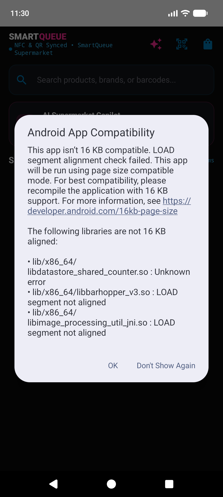
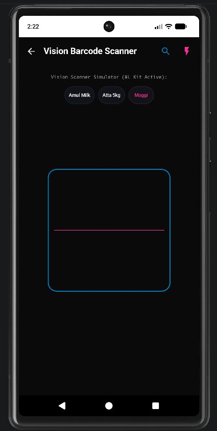
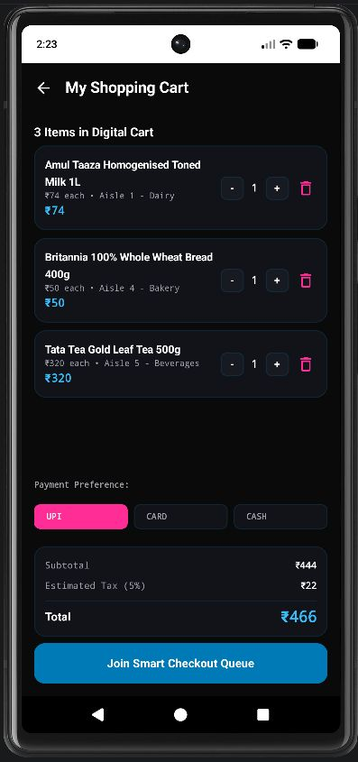
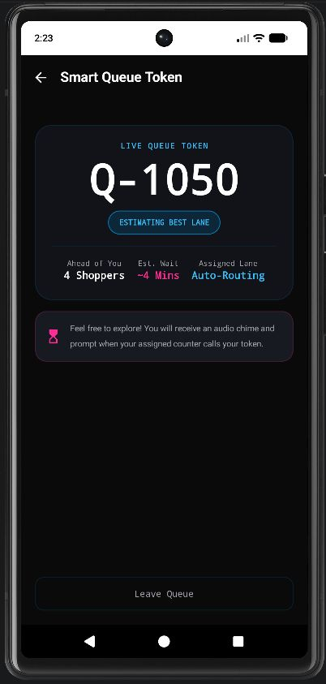
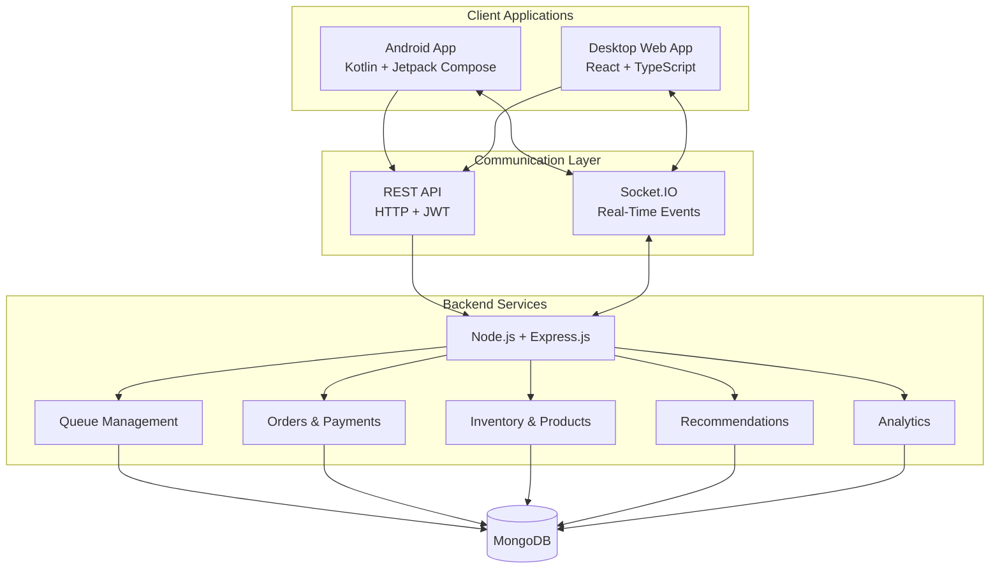

# SmartQueue

**AI-Assisted Supermarket Shopping & Real-Time Queue Management**

SmartQueue is a full-stack supermarket management and customer shopping platform designed to improve the in-store shopping experience and streamline checkout operations. It combines a native Android customer application with a React-based desktop dashboard, connected through a shared Node.js backend and MongoDB database.

Customers can browse products, build shopping carts, scan barcodes, and track checkout queues. Cashiers manage checkout operations, while managers and administrators oversee inventory, store activity, and operational analytics.

> **Project status:** Academic / development project. Some capabilities require physical hardware, external services, or production configuration. Demo analytics are generated using simulated data.

---

## Screenshots

### Desktop & Mobile Experience

| Home / Landing Page | Mobile Scanner |
|---|---|
|  |  |

| Shopping Cart | Queue Ticket |
|---|---|
|  |  |

---

## Key Features

### Customer Android Application
- Customer registration and authentication.
- Product catalogue with category browsing and search.
- Shopping cart and quantity management.
- Barcode scanning using CameraX and Google ML Kit.
- Manual barcode entry and quick-simulation options for testing.
- Checkout counter selection and queue ticket generation.
- Real-time queue position and status tracking.
- Store identification through QR and NFC workflows.
- Shopping assistant and product recommendation features.

### Cashier Desktop Application
- Cashier authentication and role-based access.
- Checkout counter status management.
- Real-time queue monitoring.
- Customer calling and order processing workflows.
- Order verification and transaction completion.
- Live queue updates through Socket.IO.

### Manager Dashboard
- Operational overview and KPI cards.
- Inventory and product management.
- Stock monitoring and low-stock indicators.
- Checkout counter monitoring.
- Sales and order analytics.
- Cashier performance information.

### Administrator Dashboard
- Store management and configuration.
- Employee account management.
- Role-based access control.
- Audit and system monitoring features.
- Queue configuration.

### AI & Recommendation Features
- Frequently bought together recommendations.
- Trending and popular product suggestions.
- Healthy product alternatives based on nutritional information.
- Personalized recommendations using purchase history.
- Shopping assistant workflows.

---

## Technology Stack

| Layer | Technologies |
|---|---|
| Desktop frontend | React 18, TypeScript, Vite |
| Android application | Kotlin, Jetpack Compose, Material 3 |
| Android architecture | MVVM, Clean Architecture |
| Backend | Node.js, Express.js |
| Database | MongoDB, Mongoose |
| Real-time communication | Socket.IO |
| Authentication | JWT, role-based access control |
| Android networking | Retrofit, OkHttp |
| Local Android storage | Room, DataStore |
| Barcode scanning | CameraX, Google ML Kit |
| Android voice features | SpeechRecognizer, TextToSpeech |
| Desktop data handling | TanStack Query, Axios |
| Analytics visualizations | Recharts |
| Dependency injection | Dagger Hilt |

---

## System Architecture

SmartQueue uses a shared backend architecture. Both client applications communicate with the same REST API and real-time event layer.



---

## Project Structure

```text
SmartQueue/
│
├── backend/
│   ├── src/
│   │   └── utils/
│   │       ├── seedData.js
│   │       └── seedDemoSimulation.js
│   ├── server.js
│   ├── package.json
│   └── .env.example
│
├── desktop/
│   ├── src/
│   └── package.json
│
├── mobile/
│   └── SmartQueueAndroid/
│       ├── app/
│       └── gradle files
│
├── docs/
│   ├── AI_FEATURES.md
│   ├── ANDROID_APPLICATION.md
│   ├── API_DOCUMENTATION.md
│   ├── COMPLETE_SYSTEM_AUDIT.md
│   ├── CUSTOMER_WORKFLOWS.md
│   ├── DATABASE_DESIGN.md
│   ├── DEPLOYMENT_GUIDE.md
│   ├── DESKTOP_APPLICATION.md
│   ├── KNOWN_LIMITATIONS.md
│   ├── PROJECT_OVERVIEW.md
│   ├── QUEUE_WORKFLOWS.md
│   ├── SYSTEM_ARCHITECTURE.md
│   ├── TESTING_REPORT.md
│   └── SMARTQUEUE_DEMO_DATA_REPORT.md
│
└── README.md
```

---

## Getting Started

### Prerequisites

Install the following before running the project:

- Node.js 20 or later
- npm
- MongoDB Community Server
- Android Studio (for the Android application)
- Android SDK and an emulator or physical Android device
- Git

### 1. Clone the repository

```bash
git clone https://github.com/Dinesh31698/SmartQueue.git
cd SmartQueue
```

### 2. Configure the backend

Install backend dependencies:

```bash
npm install --prefix backend
```

Create your environment file:

**Windows PowerShell:**

```powershell
Copy-Item backend/.env.example backend/.env
```

Open `backend/.env` and configure the required values:

```env
NODE_ENV=development
PORT=5000
MONGODB_URI=mongodb://127.0.0.1:27017/smartqueue
JWT_SECRET=REPLACE_WITH_A_LONG_RANDOM_SECRET
JWT_EXPIRES_IN=7d
CORS_ORIGIN=http://localhost:5173,http://localhost:3000
DEFAULT_STORE_ID=STORE-001
DEFAULT_STORE_NAME=SmartQueue Supermarket Flagship
RATE_LIMIT_WINDOW_MS=900000
RATE_LIMIT_MAX=200
```

Replace the JWT placeholder with a strong, randomly generated secret. Never commit your actual `.env` file.

### 3. Start MongoDB

Make sure your MongoDB service is running locally.

The default development connection is:

```text
mongodb://127.0.0.1:27017/smartqueue
```

You can use MongoDB Compass to inspect the database.

### 4. Initialize the database

Run the baseline seed script:

```bash
npm run seed --prefix backend
```

To populate the database with additional simulated operational activity:

```bash
npm run seed:demo --prefix backend
```

The demo simulation is intended for development and demonstration purposes. Its generated transactions and analytics are not real supermarket business results.

### 5. Start the backend

```bash
npm run dev --prefix backend
```

The backend runs at:

```text
http://localhost:5000
```

Health check:

```text
http://localhost:5000/api/health
```

### 6. Start the desktop application

Open a second terminal:

```bash
npm install --prefix desktop
npm run dev --prefix desktop
```

Open the local development URL displayed by Vite. The default is:

```text
http://localhost:5173
```

### 7. Run the Android application

1. Open Android Studio.
2. Select **Open** and choose `mobile/SmartQueueAndroid`.
3. Allow Gradle synchronization to complete.
4. Start an Android emulator or connect a physical device.
5. Confirm the Android API base URL points to your running backend.
6. Build and run the application.

For the Android emulator, the host machine is accessible through:

```text
http://10.0.2.2:5000/api/
```

For a physical Android device, configure the API base URL to use your development computer's LAN IP address. Both devices must be on a network that allows them to communicate.

---

## Demo Data

SmartQueue provides database seed scripts for development and demonstrations.

| Command | Purpose |
|---|---|
| `npm run seed --prefix backend` | Creates baseline store and application data |
| `npm run seed:demo --prefix backend` | Adds simulated operational activity |

Demo data may include sample customers, orders, payments, queue activity, and analytics.

**Important:** Do not interpret simulated revenue, order counts, or queue statistics as real-world business performance.

Demo account details should be obtained from the current seed configuration. Do not use production credentials for local testing.

---

## Hardware & Integration Notes

- **Barcode scanning:** The CameraX and ML Kit workflow is implemented. Emulator testing can use manual barcode entry and built-in simulation options; physical package scanning should be validated on a real device.
- **NFC:** Requires an NFC-enabled physical Android device and a correctly programmed NFC tag.
- **Payments:** Development payment workflows support transaction records and ledger updates. Live payment processing requires a payment provider, merchant registration, API credentials, and webhook configuration.
- **Network access:** Android emulators and physical devices require different backend addresses. Configure the correct API base URL for the environment.

For additional details, see [Known Limitations](docs/KNOWN_LIMITATIONS.md).

---

## Documentation

Detailed technical documentation is available in the `docs/` directory.

| Document | Description |
|---|---|
| [Project Overview](docs/PROJECT_OVERVIEW.md) | Project goals, objectives, and user roles |
| [System Architecture](docs/SYSTEM_ARCHITECTURE.md) | Application architecture and communication |
| [Desktop Application](docs/DESKTOP_APPLICATION.md) | Desktop modules and workflows |
| [Android Application](docs/ANDROID_APPLICATION.md) | Mobile architecture and customer workflows |
| [AI Features](docs/AI_FEATURES.md) | Recommendation and assistant features |
| [API Documentation](docs/API_DOCUMENTATION.md) | Backend API reference |
| [Database Design](docs/DATABASE_DESIGN.md) | Database models and structure |
| [Customer Workflows](docs/CUSTOMER_WORKFLOWS.md) | Customer shopping journeys |
| [Queue Workflows](docs/QUEUE_WORKFLOWS.md) | Queue lifecycle and processing |
| [Deployment Guide](docs/DEPLOYMENT_GUIDE.md) | Deployment guidance |
| [Testing Report](docs/TESTING_REPORT.md) | Testing documentation |
| [System Audit](docs/COMPLETE_SYSTEM_AUDIT.md) | System audit report |
| [Demo Data Report](docs/SMARTQUEUE_DEMO_DATA_REPORT.md) | Simulated data details |
| [Known Limitations](docs/KNOWN_LIMITATIONS.md) | Hardware, integration, and environment constraints |

---

## Development Commands

### Backend

```bash
npm run dev --prefix backend
npm start --prefix backend
npm test --prefix backend
npm run seed --prefix backend
npm run seed:demo --prefix backend
```

### Desktop

```bash
npm run dev --prefix desktop
npm run build --prefix desktop
npm run preview --prefix desktop
npm run lint --prefix desktop
```

### Android

Open the Android project in Android Studio and use Gradle to build, test, and run the application.

For a release APK:

```bash
cd mobile/SmartQueueAndroid
gradlew.bat assembleRelease
```

On macOS or Linux:

```bash
./gradlew assembleRelease
```

---

## Future Improvements

Potential areas for further development include:

- Production payment gateway integration.
- Cloud deployment and production monitoring.
- Extended physical-device testing.
- Performance and scalability testing under concurrent workloads.
- Improved offline synchronization and recovery.
- Further recommendation model evaluation.
- Enhanced security auditing and deployment hardening.

---

## Contributing

Contributions, suggestions, and bug reports are welcome.

1. Fork the repository.
2. Create a feature branch.
3. Make your changes.
4. Test the changes locally.
5. Submit a pull request with a clear description.

---

## Author

**SmartQueue** — Developed as a full-stack academic project exploring intelligent supermarket shopping, checkout operations, real-time communication, and AI-assisted customer experiences.

GitHub Repository: [Dinesh31698/SmartQueue](https://github.com/Dinesh31698/SmartQueue)

---

*Built with React, Kotlin, Node.js, MongoDB, and Socket.IO.*
