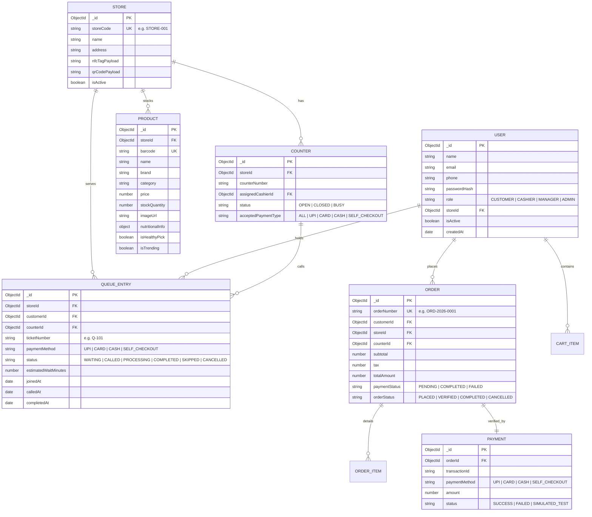

# SmartQueue — Database Design & Schema Specifications

The system utilizes MongoDB with Mongoose ODM for structured, indexed, and validated document persistence.

## Schema Validation & Indexes
- **Product**: Unique compound index on `storeId + barcode`.
- **Queue Entry**: Unique active index on `storeId + ticketNumber` for active states.
- **Order**: Unique index on `orderNumber`.
- **User**: Unique sparse indexes on `email` and `phone`.
