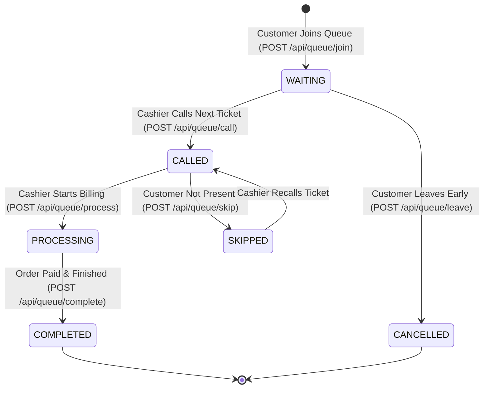

# SmartQueue — Queue Management Workflows

## 1. Queue Lifecycle State Machine

## 2. Dynamic Estimation Algorithm
Estimated wait time is calculated as:
$$\text{EstimatedWait} = (\text{Tickets Ahead}) \times (\text{Average Service Time per Ticket for Counter}) + \text{Buffer}$$

Default average service time per ticket: 2.5 minutes (re-calculated dynamically by the analytics engine based on actual past 20 completed transactions).

## 3. Strict Concurrency & Anti-Collision Rules
- Queue tickets are generated using atomic sequence counters on MongoDB (`$inc` on `CounterSequence`).
- Unique composite index `{ storeId: 1, ticketNumber: 1, date: 1 }` prevents ticket collision.
- Customers can hold at most **one** active queue ticket at any given store at a time.
- Queue status updates broadcast exclusively to the store-specific room and customer socket channel.
