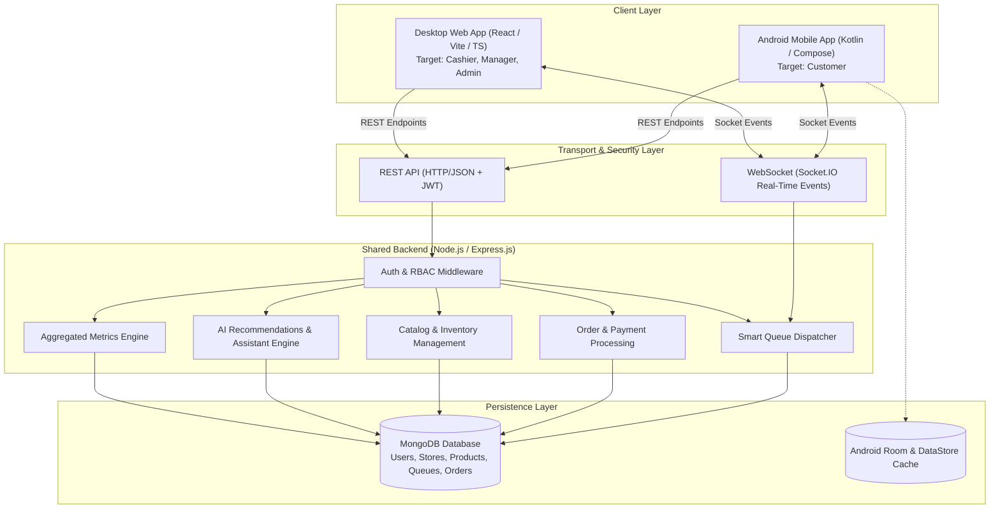

# SmartQueue — System Architecture

## 1. Architectural Principles
1. **Single Source of Truth**: All queue sequences, tickets, stock validations, and order totals originate from and are verified by the Node.js / MongoDB backend.
2. **Real-time Event Driven**: All queue status changes (JOINED, CALLED, PROCESSING, COMPLETED, SKIPPED, CANCELLED) trigger instant Socket.IO room broadcasts.
3. **Layered Separation**:
   - Android App uses MVVM + Clean Architecture (`domain`, `data`, `presentation`).
   - Desktop App uses modular component architecture, TanStack Query / Axios, and Role Protected Routes.
   - Backend follows modular service-controller-repository pattern.
